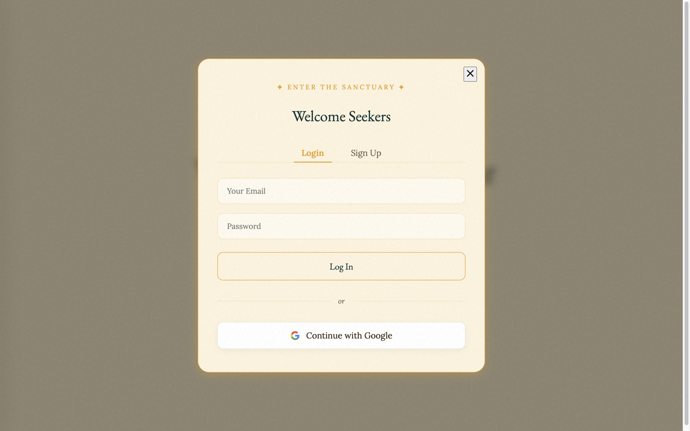

<div align="center">

# 🦚 Ask Krishna

**Seek Divine Guidance Through the Wisdom of the Bhagavad Gita**

<a href="https://python.org">
  
</a>
<a href="https://fastapi.tiangolo.com/">
  
</a>
<a href="https://supabase.com/">
  
</a>
<a href="https://groq.com/">
  
</a>

<br>

<br><br>

</div>

---

## ✨ Features \& Capabilities

**Ask Krishna** is a full-stack prototype for asking questions about the Bhagavad Gita. It retrieves relevant verses and uses Groq to generate a response, with a FastAPI backend and a browser UI styled around **Sacred Minimalism**. The backend requires configured Groq and Supabase services; an end-to-end response flow has not been verified in this checkout.

*   🔐 **Secure Authentication**: Email/Password and Google OAuth login flows powered by Supabase GoTrue.
*   📖 **"Your Journey" History**: Persistent chat sessions stored in PostgreSQL. Revisit past dialogues via a beautiful, journal-style sidebar.
*   💎 **Freemium Tiering**: Intelligent rate-limiting and usage tracking. Free users receive 5 divine answers per day before triggering a "Pro" upgrade modal.
*   🖼️ **Viral Share Cards**: Generates gorgeous, downloadable image cards of verses using `html2canvas`, optimized for Instagram, Twitter, and WhatsApp.
*   ⭐ **Saved Wisdom**: Users can bookmark verses that resonate with them, storing them in a dedicated Supabase table for later reflection.
*   👋 **Personalized Onboarding**: A welcoming modal for new souls with "Suggestion Chips" to instantly jumpstart their journey.
*   👍 **Feedback Loop**: Users can thumbs-up or thumbs-down responses to help curate the AI's instruction set over time.
*   📊 **Admin Dashboard**: A secure control panel (`admin.html`) to monitor total users, active subscriptions, and daily platform usage metrics.
*   📨 **Notification Worker**: A background Python script (`worker.py`) built to simulate the dispatch of "Daily Verses" and re-engagement emails.

---

## 📸 Screenshots

These are captures of the repository's actual frontend. The desktop sign-in panel was opened by clicking **Begin Your Journey**; no account details were entered. The narrow capture is approximately 480 CSS pixels wide, produced with 300% browser zoom in Chrome because the available Aside browser did not expose viewport resizing.

<div align="center">
  
  <br />
  <sub>Desktop sign-in panel (1440 × 900)</sub>
  <br /><br />
  
  <br />
  <sub>Narrow landing view (~480 CSS px effective width)</sub>
</div>

The captures verify the frontend presentation only. The FastAPI server could not be started in this environment (`uvicorn` is not installed, and `GROQ_API_KEY`, `SUPABASE_URL`, and `SUPABASE_ANON_KEY` are absent), so authentication, database access, and generated answers were not exercised.

---

## 🛠 Tech Stack \& Architecture

| Component | Technology | Description |
| :--- | :--- | :--- |
| **Backend** | `FastAPI` | High-performance Python async framework handling APIs and SSE streaming. |
| **Database & Auth** | `Supabase` | Managed PostgreSQL with Row-Level Security (RLS) and JWT auth. |
| **AI Engine** | `Groq Cloud` | Utilizing Llama 3 for blazing-fast inference and conversational persona. |
| **RAG/Embeddings** | `SentenceTransformers` | Local `all-MiniLM-L6-v2` model for semantic retrieval of Gita verses. |
| **Frontend** | `HTML/CSS/JS` | Pure vanilla implementation. Zero bloat, ensuring maximum performance. |

---

## 🚀 Getting Started (Local Development)

### 1. Prerequisites
You will need **Python 3.9+** and a **Supabase** project.

### 2. Environment Variables
Create a `.env` file in the root directory and securely populate your keys:
```env
GROQ_API_KEY=your_groq_api_key_here
SUPABASE_URL=https://your-project.supabase.co
SUPABASE_ANON_KEY=your_supabase_anon_key_here
```

### 3. Database Migration
Run the provided SQL script `supabase_setup_usage.sql` in your Supabase SQL Editor. This initializes the `chat_sessions`, `chat_messages`, `user_usage`, and `saved_verses` tables along with their RLS policies.

### 4. Installation
Create a virtual environment and install the dependencies to keep your system clean:
```bash
python -m venv venv
source venv/bin/activate  # On Windows: venv\Scripts\activate
pip install -r requirements.txt
```

### 5. Running the Application
Start the FastAPI server:
```bash
uvicorn app:app --host 0.0.0.0 --port 8000 --reload
```
The divine experience will be available at `http://localhost:8000`.

---

## Deployment

`render.yaml` describes a Render web service. No `.vercel` project linkage was found locally, and the Vercel CLI is unavailable in this environment, and no Vercel deployment was tested. The FastAPI app loads PyTorch/SentenceTransformers and a local embeddings file during startup, so package size, cold start, memory use, and file access would need validation before recommending Vercel. The README's former `geetabot.com` status badge was removed: on 2026-10-16, that hostname failed DNS resolution (`DNS_PROBE_FINISHED_NXDOMAIN`), so a live deployment could not be verified.

## 🎨 Design Philosophy: *Sacred Minimalism*

The UI ditches the generic "SaaS look" for an ancient, premium, temple-like atmosphere.
*   **Midnight** (`#1A1200`) and **Warm Parchment** (`#FDF3DC`) contrasts.
*   **Marigold Gold** (`#E8A020`) and **Peacock Teal** (`#1A6B72`) accents.
*   Typography relies on **Yeseva One** and **Crimson Pro** for a readable, classic-feeling body text.

<div align="center">
  <br>
  <i>Built with reverence as a portfolio project.</i>
</div>

## Project presentation

A static, screenshot-led portfolio page for this project is live at [ask-krishna.devayushrout.me](https://ask-krishna.devayushrout.me). It shows the captured frontend only; it does not provide a live chat, authentication, verse retrieval, or database access. See the setup notes above for the separate FastAPI application's requirements and current verification limits.
